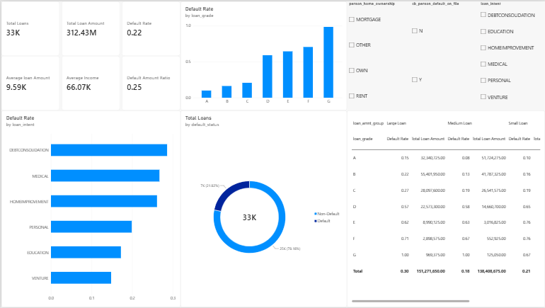
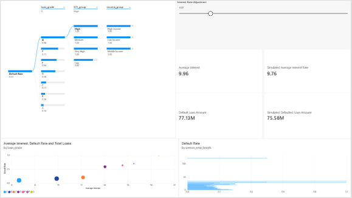
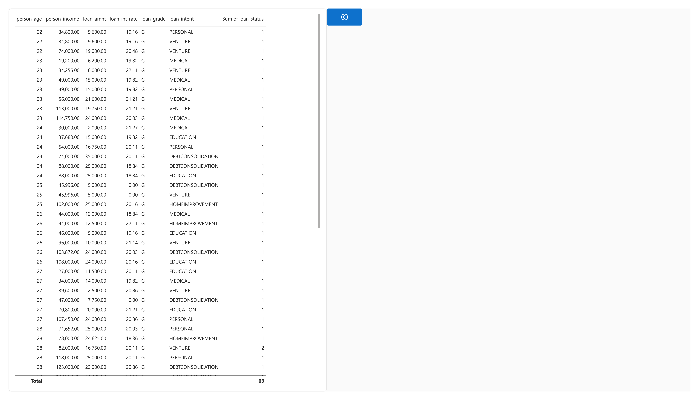

# Credit Risk & Loan Default Analysis | Power BI Portfolio

## Project Introduction

Use Power BI, Power Query, and DAX to analyze credit risk and loan default data, identify major default risk drivers, and support credit risk monitoring and lending decisions.

## Data Source

- Kaggle: Credit Risk Dataset
- Link: https://www.kaggle.com/datasets/laotse/credit-risk-dataset
- Key fields: person_age, person_income, person_emp_length, person_home_ownership, loan_amnt, loan_int_rate, loan_grade, loan_intent, loan_percent_income, cb_person_default_on_file, loan_status

## Tools

Power BI Desktop, Power Query, DAX

## Analysis Process

1. Data cleaning using Power Query.
2. Create age groups, income groups, loan amount groups, DTI groups, and default labels.
3. Create DAX measures for loan amount, default rate, average interest rate, and default amount ratio.
4. Create three report pages: Executive Summary, Risk Driver Analysis, and Detail Drillthrough.
5. Add a What-If parameter to simulate interest rate changes and analyze their impact on loan portfolio risk.

## Report Pages

### Page 1: Executive Summary

### Page 2: Risk Driver Analysis

### Page 3: Detail Drillthrough

## Power BI File

Power BI source file available in the `pbix` folder.
